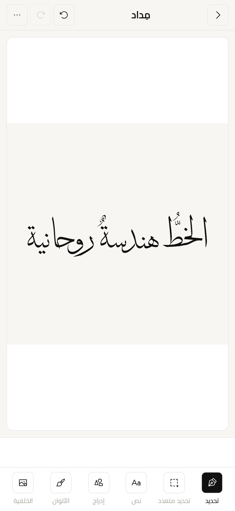

# midad

An Arabic calligraphy studio for iOS, Android and the web — built with
[Expo](https://expo.dev), [React Native Skia](https://shopify.github.io/react-native-skia)
and Skia's HarfBuzz-shaped Paragraph API.

[Try it in the browser](https://midad.adelpro.us.kg) · `0.6.0-rc.2`

Write a word in a calligraphic face, place it on an A4 canvas, then take it
apart: split a line into words, a word into letter clusters, regroup the
clusters in place, and export the result as PNG or SVG. Everything stays on the
device — no account, no upload, no round trip.



## What is in here

- **Arabic text that is actually shaped.** Text runs through the Paragraph API,
  so ligatures, contextual forms and diacritics come from the font rather than
  from a layout approximation. The contract is
  [`docs/editor-text-engine.md`](docs/editor-text-engine.md).
- **Cluster split and rejoin.** A shaped word can be cut at cluster boundaries,
  moved, recoloured and rejoined without breaking its shaping — the hard part
  of the whole editor, written up in
  [`docs/editor-split-and-rejoin.md`](docs/editor-split-and-rejoin.md).
- **One render contract.** The canvas, the PNG export and the SVG export have
  to agree, and the rules that keep them agreeing are in
  [`docs/editor-render-contract.md`](docs/editor-render-contract.md).
- **32 type families** in the picker (49 bundled faces), from Amiri and Aref
  Ruqaa to the Thuluth cuts, plus a runtime picker for Google Fonts that are
  never bundled.
- **RTL-first UI** with Arabic copy as the source language.
- **No backend.** Designs, collections and background images live in local
  storage; the app makes no account or sync calls.

## Documentation

[`docs/`](docs/) holds one behavior contract per editor subsystem. Each records
what the code cannot tell you on its own — the invariants, the traps, and the
trade-offs that were decided once. When a document and the code disagree, fix the
code.

| Document                                                              | Covers                                               |
| --------------------------------------------------------------------- | ---------------------------------------------------- |
| [`editor-selection.md`](docs/editor-selection.md)                     | Select tool, multi-select, background image flow     |
| [`editor-state-and-history.md`](docs/editor-state-and-history.md)     | Store slices, undo/redo, `sizedObjects`, z-order     |
| [`editor-coordinates.md`](docs/editor-coordinates.md)                 | The four frames, fit-to-view, selection chrome       |
| [`editor-render-contract.md`](docs/editor-render-contract.md)         | Canvas ↔ PNG ↔ SVG agreement                         |
| [`editor-text-engine.md`](docs/editor-text-engine.md)                 | Arabic shaping, auto width, paragraph lifetime       |
| [`editor-split-and-rejoin.md`](docs/editor-split-and-rejoin.md)       | The cluster split/rejoin algorithm                   |
| [`editor-collections.md`](docs/editor-collections.md)                 | Collections: groups, split words, the collection bar |
| [`editor-groups.md`](docs/editor-groups.md)                           | Group membership and the whole-groups invariant      |
| [`editor-gestures.md`](docs/editor-gestures.md)                       | Tap/pan/pinch/rotate, resize, release settle         |
| [`editor-selection-bar.md`](docs/editor-selection-bar.md)             | The action rail, width budget, pins                  |
| [`editor-keyboard.md`](docs/editor-keyboard.md)                       | Binding table, matcher, chord text                   |
| [`editor-help-and-learn-mode.md`](docs/editor-help-and-learn-mode.md) | Help catalog, learn mode                             |

Also:

- [`DESIGN.md`](DESIGN.md) — the midad visual language (single source of truth).
- [`CHANGELOG.md`](CHANGELOG.md) — what changed, release by release.
- [`docs/web-hydration.md`](docs/web-hydration.md) — why the root layout renders
  nothing on its first pass in the browser.

## Run it locally

```bash
yarn install
npx expo start
```

The dev server prints the targets it can open: a development build, an Android
emulator, an iOS simulator, or the browser (`yarn web`). Expo Go runs the
project as a sandbox; the native modules the editor depends on need a
development build.

### Code quality and commits

This project uses Yarn, Prettier, ESLint, TypeScript, Husky, and Commitlint.
The format check covers repository configuration and documentation while the
pre-commit hook formats every staged source file.
Install [Gitleaks](https://github.com/gitleaks/gitleaks#installation) locally
before committing; the pre-commit hook scans staged changes for secrets.

```bash
yarn format
yarn format:check
yarn lint
yarn type-check
yarn build:check
yarn secrets:check
```

Commit messages must follow the Conventional Commits format, for example:
`feat(editor): add snap guides`. GitHub Actions runs the same checks, rejects
competing lockfiles, validates pull-request commit messages, and scans the
repository for secrets.

## Checking your work

There is no test runner. `yarn verify` is the gate: it runs the typecheck, the
lint, the format check and ten standalone behaviour checks in parallel, and
fails if any of them did. `--serial` runs them one after another when you want
to read them in order.

```bash
yarn verify                      # everything, in parallel
yarn typecheck                   # tsc --noEmit, incremental
yarn lint                        # eslint src scripts, cached
yarn format                      # prettier --check ., cached
node scripts/check-clusters.mjs  # Arabic split segmentation + round-trip
node scripts/check-groups.mjs    # group membership + the whole-groups invariant
node scripts/check-shortcuts.mjs # binding table + matcher + chord text
node scripts/check-help.mjs      # help catalog ↔ strings.ts ↔ shortcuts.ts
```

The first run of each is the slow one: the typecheck writes `.cache/tsconfig.tsbuildinfo`, the lint writes `.eslintcache` and the format check writes `.prettiercache` at the repo root — all gitignored — and later runs only redo what changed. Delete those three to force a cold run.

## License

The code is [MIT](LICENSE). Bundled fonts are redistributed under their own
licenses — OFL-1.1 for thirty-two families, MIT for Bouazzi Maghribi and
Apache-2.0 for Yellowtail — recorded face by face with copyright and source in
[`assets/fonts/LICENSES.md`](assets/fonts/LICENSES.md).

The MIT license covers the code. The name `midad`, the app icon and the splash
art are not part of it.

## Contributing

Issues and pull requests are welcome, especially around Arabic shaping and
cluster segmentation. Run `yarn verify` before opening a pull request, and keep
commits in Conventional Commits format.
